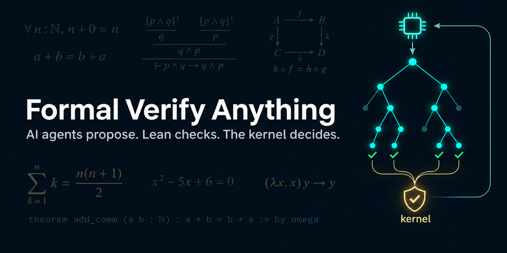

<div align="center">

# Formal Verify Anything

### Agentengesteuerte Beweissuche für Lean 4 und Mathlib.

**KI-Agenten schlagen vor. Lean prüft. Der Kernel entscheidet.**

[](https://github.com/allsmog/Formal-Verify-Anything/actions/workflows/formal.yml)
[](https://github.com/allsmog/Formal-Verify-Anything/releases)
[](../lean-toolchain)
[](../lake-manifest.json)
[](../LICENSE)
[](https://github.com/allsmog/Formal-Verify-Anything/discussions)

[English](../README.md) · [简体中文](README.zh-CN.md) · [日本語](README.ja.md) · [한국어](README.ko.md) · [Español](README.es.md) · **Deutsch**

Dies ist eine Übersetzung. Maßgeblich ist die englische README, die auch aktueller sein kann.

**[Website](https://allsmog.github.io/Formal-Verify-Anything/) · [Anleitungen](https://allsmog.github.io/Formal-Verify-Anything/guides/) · [Showcase](https://allsmog.github.io/Formal-Verify-Anything/showcase/) · [Diskussionen](https://github.com/allsmog/Formal-Verify-Anything/discussions)**

[Schnellstart](#quick-start) · [Mit deinem Agenten verwenden](#use-it-with-your-agent) · [Funktionsweise](#how-it-works) · [Ergebnisse](#results) · [Sicherheitsbeispiel](#security-example)



</div>

---

Formuliere ein Theorem in Lean. Lass einen KI-Agenten nach dem Beweis suchen. Behalte nur, was der Lean-Kernel akzeptiert.

Ein Agent (über die Codex CLI) oder eine deterministische Taktik-Policy schlägt Beweisschritte vor. Lean kompiliert jeden Schritt und meldet die neuen Ziele, fehlgeschlagene Zweige werden genau auf den Elternplan zurückgesetzt, und ein Beweis wird erst nach zwei frischen Kompilierungen und einem Kernel-Abhängigkeitsaudit akzeptiert. Jeder Versuch, jeder Zielzustand und jeder Beleg wird gespeichert, sodass du nachvollziehen kannst, wie jeder Beweis gefunden wurde, und ihn selbst prüfen kannst.

Auf einem eingefrorenen Holdout-Set aus 24 miniF2F-Problemen löste der Codex-Agent **17/24** und die deterministische Baseline **11/24**. Jeder akzeptierte Beweis bestand ein Kernel-Audit und eine unabhängige Neukompilierung. Siehe [Ergebnisse](#results).

**Der Standard-Solver ist eine deterministische Taktiksuch-Baseline.** Sie ruft kein Modell auf. Ein explizit gewählter Codex-CLI-Adapter oder ein vertrauenswürdiger lokaler Befehl kann modellgenerierte Vorschläge mit eingegrenztem Zielkontext und Compiler-Feedback liefern; diese Vorschläge durchlaufen dieselbe Validierung. Deterministische Ergebnisse und Fixture-Tests werden nie als gemessene Modellleistung dargestellt.

Version 0.2 enthält eine Reparatur, die die finale Verifikation berücksichtigt, einen optionalen persistenten Lean-Explorations-Worker, einen Vergleich auf einem eingefrorenen Holdout-Set aus 24 Problemen und ein auditiertes Sicherheitsmodell für atomare Token.

<a id="quick-start"></a>
## Schnellstart

Voraussetzungen: Node.js 22 oder neuer, Git und [elan](https://github.com/leanprover/elan).
Das Repository pinnt Lean 4.24.0 und einen exakten Mathlib-Commit.

```sh
git clone https://github.com/allsmog/Formal-Verify-Anything.git
cd Formal-Verify-Anything
npm ci --prefix formal
lake exe cache get
lake build
node formal/src/cli.mjs doctor
node formal/src/cli.mjs solve benchmarks/tier1.json --id conjunction_commutation
```

Die `formal/`-Laufzeit ist reines JavaScript ohne npm-Abhängigkeiten.

<a id="use-it-with-your-agent"></a>
## Mit deinem Agenten verwenden

Die CLI nimmt ein JSON-Problemmanifest entgegen und gibt ein JSON-Ergebnis aus, daher kann jeder Coding-Agent, der Terminalbefehle ausführen kann, sie steuern. Verweise deinen Agenten auf dieses Repository und bitte ihn:

```text
Write my lemma as a Formal Verify Anything problem manifest, run
`node formal/src/cli.mjs solve` on it with `--proposer codex`, and show me the
accepted proof, the attempts it pruned, and the kernel audit.
```

Um einen Agenten als Proposer innerhalb der Suchschleife zu verwenden, authentifiziere die Codex CLI (ChatGPT-Login oder API-Schlüssel) und übergib `--proposer codex`. Jedes andere Modell lässt sich über `--proposer-command` anbinden, ein lokales Programm, das eine JSON-Anfrage von stdin liest und Vorschläge zurückgibt; siehe [formal/README.md](../formal/README.md). Egal, was die Schritte vorschlägt: Akzeptiert werden nur Beweise, die Lean und das Kernel-Audit bestehen.

<a id="how-it-works"></a>
## Funktionsweise

1. Sperrt die ursprüngliche Theoremdeklaration, die Imports und den Hash der Aussage.
2. Lässt Lean das aktuelle Ziel, die Hypothesen, abhängige lets, Universumsparameter und die Zielstruktur melden.
3. Sendet nur diesen lokalen Kontext an eine Vorschlags-Policy. Vorschläge können Taktiken, case/induction-Aufteilungen oder ein strukturiertes `have`-Hilfslemma mit Fortsetzung verwenden.
4. Spielt jeden Zweig in einer frischen Datei mit dem ursprünglichen Theorem erneut ab. Fehlgeschlagene Zweige stellen genau den Elternplan wieder her; jeder Versuch behält Quelltext, Diagnosen, Exit-Code, Laufzeit und Evidenz-Digest.
5. Teilt die Budgets für Compiler-Aufrufe, Vorschlagsschritte, Tiefe, Heartbeats, Modell-Token und Wall-Time über den gesamten Rekursionsbaum.
6. Gibt einen gelösten Beweis erst aus, wenn zwei frische, eigenständige Compiler-Aufrufe erfolgreich sind, die ursprüngliche Deklaration unverändert ist und ein Abhängigkeitsaudit die Theoremdeklaration im Kernel akzeptiert.

Lehnt die finale Verifikation einen lokal geschlossenen Beweis ab, setzt die Suche mit dem verbleibenden gemeinsamen Budget und dem Compiler-Feedback fort. Sie kann einen früheren Geschwisterzweig reparieren oder eine Zerlegung ändern. `--compiler worker` verwendet importierte Bibliotheken während der Exploration wieder, während beide finalen Prüfungen weiterhin in frischen Lean-Prozessen laufen.

Zwischenproben schlagen nach dem Melden ihrer Ziele absichtlich mit einem privaten Sentinel fehl. Ein vom Elaborator beobachteter Zustand ist kein gelöstes Theorem. Frühere Compiler-Fehler machen eine Probe ungültig, selbst wenn eine spätere Fehlerbehandlung keine offenen Ziele meldet.

Das finale Gate lehnt `sorry`, `admit`, neue `axiom`-Deklarationen, lexikalische Escapes, beliebige Elaborator-Befehle und Abkürzungen, die das Compiler-Vertrauen umgehen, ab. Es prüft die transitiven Beweisabhängigkeiten und erlaubt nur die üblichen grundlegenden Axiome von Lean: `propext`, `Classical.choice` und `Quot.sound`.
Unter der v2-Policy ist nur genau die Linter-Warnung für unbenutzte Variablen zulässig; sie bleibt im Beleg sichtbar. Andere Warnungen führen weiterhin zur Ablehnung.

<a id="results"></a>
## Ergebnisse

```sh
# Meaningful unit and real Lean integration checks
FVA_INTEGRATION=1 npm test --prefix formal

# Frozen 24-problem v2 evaluation, with a real provider-availability preflight
node benchmarks/v2/run.mjs --provider both --compiler worker

# Diagnostic v1 reruns never overwrite the published v1 results
node benchmarks/run.mjs --only mathd_algebra_142
```

[benchmarks/results.md](../benchmarks/results.md) enthält die gemessenen Ergebnisse, das Budget, Compiler-Aufrufe und Rekursionstiefe pro Theorem, Fehlschläge sowie Links zu jedem erzeugten Beweis und Versuch. Die zwölf miniF2F-Testaussagen wurden vor jedem Solver-Lauf anhand des Dateinamens ausgewählt. Jeder ausgewählte Fehlschlag bleibt im Nenner. Siehe [Herkunft der Benchmarks](../benchmarks/README.md).

Die kanonische **v1**-Baseline akzeptierte **5/5 grundlegende Theoreme und 8/12 miniF2F-Probleme: insgesamt 13/17 (76.5%)**. Sie machte **414 Compiler-Aufrufe**, erreichte Rekursionstiefe **8** und verbrauchte **0 Modell-Token**. Alle vier Fehlschläge haben das Budget für Compiler-Aufrufe ausgeschöpft.

Die [v2-Evaluation](../benchmarks/v2/README.md) verwendet acht Aussagen aus der Algebra, acht aus der Zahlentheorie und acht zur Induktion, disjunkt zu diesen zwölf miniF2F-Einträgen. Ihre Auswahl und die exakten Deklarationen wurden vor jeder v2-Suche eingefroren. Im gepaarten Lauf bekam jede Methode pro Theorem einen begrenzten Aufruf unter denselben Limits:

| Methode | Gelöst (pass@1) | Compiler-Aufrufe | Modell-Token |
| --- | ---: | ---: | ---: |
| Codex-CLI-Proposer | **17/24** (70.8%) | 97 | 471,764 gemeldet |
| Deterministische Policy | **11/24** (45.8%) | 979 | 0 |

Codex löste jedes Theorem, das die deterministische Policy löste, und sechs weitere. Vier Codex-Aufrufe endeten mit Provider-Timeouts, die keine Token-Nutzung meldeten, daher ist die Token-Summe eine untere Schranke. Der [v2-Bericht](../benchmarks/v2/results.md) schlüsselt die Ergebnisse nach Algebra, Zahlentheorie und Induktion auf und verlinkt jeden Beweis und jeden Trace. Ein blockierter Provider-Preflight würde separat gemeldet und nie in einen Modell-Score umgerechnet.

Hier bedeutet `pass@1` einen Aufruf der **gesamten begrenzten Such-Policy** pro Theorem. Das schließt das interne Backtracking dieses Aufrufs ein. Der Erfolg mit dem ersten Kandidaten wird separat berichtet. Eine ausgeschöpfte Suche zeigt nicht, dass das Theorem falsch oder unbeweisbar ist.

Die CI verlangt den kanonischen Bericht und alle siebzehn erwarteten IDs und kompiliert dann jeden aufgezeichneten erfolgreichen Beweis neu. So führst du dasselbe Integritäts-Gate lokal aus:

```sh
node formal/scripts/recheck.mjs
```

<a id="select-a-proposer-or-compiler"></a>
## Proposer oder Compiler auswählen

```sh
# Existing Codex authentication (ChatGPT login or API key) is required
node formal/src/cli.mjs doctor --proposer codex
node formal/src/cli.mjs solve benchmarks/tier1.json \
  --id conjunction_commutation --proposer codex --compiler worker \
  --model-token-budget 50000

# Deterministic worker mode requires no model account
node formal/src/cli.mjs solve benchmarks/tier1.json --compiler worker
```

Die CLI unterstützt einen vertrauenswürdigen lokalen Befehl, der eine eingegrenzte JSON-Anfrage über stdin erhält und Vorschläge plus die gemessene Token-Nutzung zurückgibt. Er wird mit einem Argumentvektor gestartet, ohne Shell. Protokoll, Kommandozeilenoptionen und unabhängige Beweisverifikation beschreibt [formal/README.md](../formal/README.md).
Der [Codex-Adapter](../formal/docs/codex-proposer.md) zeichnet die tatsächliche Provider-Nutzung, fehlerhafte Antworten und nicht verfügbare Nutzungsdaten auf, ohne kostenfreie Anfragen zu erfinden.
Das Token-Kontingent ist eine Zulassungsschwelle, keine Abrechnungsgrenze des Providers.
Der [Worker-Leitfaden](../formal/docs/persistent-worker.md) dokumentiert Cache-Isolation, Ressourcenbesitz und Messungen kompletter Workflows.

Der Policy stehen keine ursprünglichen Beweisrümpfe der Benchmarks zur Verfügung. Imports von `MiniF2F`-Modulen sind verboten, damit Benchmark-Antworten oder per admit angenommene Deklarationen nicht versehentlich wiederverwendet werden.

<a id="security-example"></a>
## Sicherheitsbeispiel

[Das Atomic-Token-Beispiel](../examples/security/README.md) definiert eine fresh/spent-Zustandsmaschine mit autorisiertem Verbrauch und abgelehnten Selbstschleifen. Seine vier auditierten Beweise zeigen Erhaltung über endliche Traces, höchstens einmaligen Erfolg, die Ablehnung einer Wiederverwendung nach dem Verbrauch und die Unmöglichkeit zweier Erfolge. Separate Problemmanifeste importieren nur Definitionen, sodass ein Beweissuchlauf das fertige Beweismodul des Beispiels nicht wiederverwenden kann. Die Aussagen betreffen dieses abstrakte atomare Modell; sie belegen weder die Korrektheit einer Rust-Implementierung noch eine Exactly-once-Zustellung im Netzwerk.

<a id="scope-and-limits"></a>
## Umfang und Grenzen

Dies ist ein funktionierendes System zur begrenzten Beweissuche, keine Garantie, dass beliebige Lean-Theoreme gelöst werden. Die generische Policy ist bewusst klein gehalten. Case-Ziele, die über gemeinsame Metavariablen gekoppelt sind, können ein vorgeschlagenes Bullet-Layout veralten lassen; der Runner lehnt solche Zweige vorsorglich ab. Der Kontext behält alle sichtbaren lokalen Hypothesen und ihre Abhängigkeiten; er rät nicht, welche mathematischen Prämissen verzichtbar sind.

Lean, gepinnte Mathlib-Artefakte, die Beobachtungsbrücke und der konfigurierte lokale Proposer-Befehl gehören zur vertrauenswürdigen Rechenumgebung. Taktikzulassung und Kernel-Prüfungen sind keine Betriebssystem-Sandbox gegen feindselige Lean-Plugins oder feindselige lokale Befehle. Die Timeout-Behandlung über Prozessgruppen ist unter Linux und macOS getestet; das Aufräumen von Prozessfamilien unter Windows ist nicht validiert.

<a id="layout-and-licenses"></a>
## Aufbau und Lizenzen

- [formal/](../formal/): die JavaScript-Orchestrierung, Proposer und CLI.
- [FormalVerify/Bridge.lean](../FormalVerify/Bridge.lean): Lean-Zielbeobachtungen und das Kernel-Audit.
- [benchmarks/](../benchmarks/): die v1- und v2-Suites, Protokolle, Ergebnisse und vollständige Lauf-Traces.
- [examples/security/](../examples/security/): das Atomic-Token-Modell und seine Beweisaufgaben.
- [site/](../site/): Quellen der [Website](https://allsmog.github.io/Formal-Verify-Anything/); `node site/build.mjs` schreibt die veröffentlichten Seiten nach `docs/`.
- [i18n/](../i18n/): Übersetzungen dieser README.
- [SECURITY.md](../SECURITY.md): wie man eine Schwachstelle meldet und wogegen der Runner nicht schützt.
- [LICENSE](../LICENSE): MIT. Die Benchmark-Aussagen behalten ihre miniF2F-Hinweise in
  [benchmarks/licenses/](../benchmarks/licenses/).
