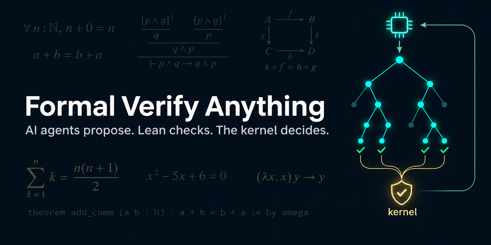

<div align="center">

# Formal Verify Anything

### Búsqueda de demostraciones guiada por agentes para Lean 4 y Mathlib.

**Los agentes de IA proponen. Lean comprueba. El núcleo (kernel) decide.**

[](https://github.com/allsmog/Formal-Verify-Anything/actions/workflows/formal.yml)
[](https://github.com/allsmog/Formal-Verify-Anything/releases)
[](../lean-toolchain)
[](../lake-manifest.json)
[](../LICENSE)
[](https://github.com/allsmog/Formal-Verify-Anything/discussions)

[English](../README.md) · [简体中文](README.zh-CN.md) · [日本語](README.ja.md) · [한국어](README.ko.md) · **Español** · [Deutsch](README.de.md)

Esta es una traducción. El README en inglés es la versión de referencia y puede estar más actualizado.

**[Sitio web](https://allsmog.github.io/Formal-Verify-Anything/) · [Guías](https://allsmog.github.io/Formal-Verify-Anything/guides/) · [Galería](https://allsmog.github.io/Formal-Verify-Anything/showcase/) · [Discusiones](https://github.com/allsmog/Formal-Verify-Anything/discussions)**

[Inicio rápido](#quick-start) · [Úsalo con tu agente](#use-it-with-your-agent) · [Cómo funciona](#how-it-works) · [Resultados](#results) · [Ejemplo de seguridad](#security-example)



</div>

---

Enuncia un teorema en Lean. Deja que un agente de IA busque la demostración. Conserva solo lo que acepta el núcleo de Lean.

Un agente (a través de Codex CLI) o una política determinista de tácticas propone pasos de demostración. Lean compila cada paso e informa de los nuevos objetivos, las ramas fallidas vuelven exactamente al plan padre, y una demostración solo se acepta tras dos compilaciones desde cero y una auditoría de dependencias del núcleo. Se guardan todos los intentos, estados de objetivos y comprobantes, así que puedes ver cómo se encontró cada demostración y comprobarla tú mismo.

En un conjunto reservado (holdout) congelado de 24 problemas de miniF2F, el agente Codex resolvió **17/24** y la línea base determinista **11/24**. Todas las demostraciones aceptadas pasaron una auditoría del núcleo y una recompilación independiente. Consulta [Resultados](#results).

**El solucionador por defecto es una línea base determinista de búsqueda de tácticas.** No hace llamadas a modelos. Un adaptador explícito de Codex CLI o un comando local de confianza puede aportar propuestas generadas por un modelo, con contexto de objetivos acotado y retroalimentación del compilador; esas propuestas pasan por la misma validación. Las puntuaciones deterministas y las pruebas con fixtures nunca se presentan como rendimiento medido de un modelo.

La versión 0.2 incluye reparación que tiene en cuenta la verificación final, un worker de exploración de Lean persistente y opcional, una comparación sobre un conjunto reservado congelado de 24 problemas y un modelo de seguridad de token atómico auditado.

<a id="quick-start"></a>
## Inicio rápido

Requisitos previos: Node.js 22 o posterior, Git y [elan](https://github.com/leanprover/elan).
El repositorio fija Lean 4.24.0 y un commit exacto de Mathlib.

```sh
git clone https://github.com/allsmog/Formal-Verify-Anything.git
cd Formal-Verify-Anything
npm ci --prefix formal
lake exe cache get
lake build
node formal/src/cli.mjs doctor
node formal/src/cli.mjs solve benchmarks/tier1.json --id conjunction_commutation
```

El runtime de `formal/` es JavaScript puro, sin dependencias de npm.

<a id="use-it-with-your-agent"></a>
## Úsalo con tu agente

La CLI recibe un manifiesto de problema en JSON e imprime un resultado en JSON, así que cualquier agente de programación capaz de ejecutar comandos de terminal puede manejarla. Indica a tu agente este repositorio y pídele:

```text
Write my lemma as a Formal Verify Anything problem manifest, run
`node formal/src/cli.mjs solve` on it with `--proposer codex`, and show me the
accepted proof, the attempts it pruned, and the kernel audit.
```

Para usar un agente como proponente dentro del bucle de búsqueda, autentica Codex CLI (con un inicio de sesión de ChatGPT o una clave de API) y pasa `--proposer codex`. Cualquier otro modelo puede conectarse mediante `--proposer-command`, un programa local que lee una solicitud JSON por stdin y devuelve propuestas; consulta [formal/README.md](../formal/README.md). Proponga quien proponga los pasos, solo se aceptan las demostraciones que pasan Lean y la auditoría del núcleo.

<a id="how-it-works"></a>
## Cómo funciona

1. Bloquea la declaración original del teorema, los imports y el hash del enunciado.
2. Pide a Lean que informe del objetivo actual, las hipótesis, los let dependientes, los parámetros de universo y la estructura del objetivo.
3. Envía solo ese contexto local a una política de propuestas. Las propuestas pueden usar tácticas, divisiones por casos o inducción, o un sublema `have` estructurado con una continuación.
4. Reproduce cada rama en un archivo nuevo que contiene el teorema original. Las ramas fallidas restauran exactamente el plan padre; cada intento conserva su código fuente, diagnósticos, código de salida, tiempo transcurrido y digest de evidencia.
5. Comparte los presupuestos de llamadas al compilador, pasos de propuesta, profundidad, heartbeats, tokens de modelo y tiempo real en todo el árbol de recursión.
6. Emite una demostración resuelta solo después de que dos invocaciones independientes y desde cero del compilador tengan éxito, su declaración original no haya cambiado y una auditoría de dependencias acepte su declaración de teorema en el núcleo.

Si la verificación final rechaza una demostración cerrada localmente, la búsqueda continúa con el presupuesto compartido restante y la retroalimentación del compilador. Puede reparar una rama hermana anterior o cambiar una descomposición. `--compiler worker` reutiliza las bibliotecas importadas durante la exploración, mientras que ambas comprobaciones finales siguen ejecutándose en procesos de Lean nuevos.

Las sondas intermedias fallan a propósito con un centinela privado después de informar de sus objetivos. Un estado observado por el elaborador no es un teorema resuelto. Los errores anteriores del compilador invalidan una sonda aunque la recuperación de errores posterior no informe de objetivos pendientes.

La puerta final rechaza `sorry`, `admit`, nuevas declaraciones `axiom`, escapes léxicos, comandos arbitrarios del elaborador y atajos que eluden la confianza en el compilador. Comprueba las dependencias transitivas de la demostración y solo permite los axiomas fundacionales habituales de Lean: `propext`, `Classical.choice` y `Quot.sound`.
Bajo la política v2 solo se permite exactamente el aviso del linter de variable no usada; sigue visible en el comprobante. Los demás avisos siguen siendo motivo de rechazo.

<a id="results"></a>
## Resultados

```sh
# Meaningful unit and real Lean integration checks
FVA_INTEGRATION=1 npm test --prefix formal

# Frozen 24-problem v2 evaluation, with a real provider-availability preflight
node benchmarks/v2/run.mjs --provider both --compiler worker

# Diagnostic v1 reruns never overwrite the published v1 results
node benchmarks/run.mjs --only mathd_algebra_142
```

[benchmarks/results.md](../benchmarks/results.md) contiene los resultados medidos, el presupuesto, las llamadas al compilador y la profundidad de recursión por teorema, los fallos y enlaces a cada demostración e intento generados. Los doce enunciados de prueba de miniF2F se seleccionaron por nombre de archivo antes de ejecutar ningún solucionador. Todos los fallos seleccionados permanecen en el denominador. Consulta la [procedencia del benchmark](../benchmarks/README.md).

La línea base canónica **v1** aceptó **5/5 teoremas fundacionales y 8/12 problemas de miniF2F: 13/17 en total (76.5%)**. Hizo **414 llamadas al compilador**, alcanzó una profundidad de recursión de **8** y usó **0 tokens de modelo**. Los cuatro fallos agotaron el presupuesto de llamadas al compilador.

La [evaluación v2](../benchmarks/v2/README.md) usa ocho enunciados de álgebra, ocho de teoría de números y ocho de inducción, disjuntos de esos doce elementos de miniF2F. Su selección y sus declaraciones exactas se congelaron antes de cualquier búsqueda v2. En la ejecución emparejada, cada método recibió una invocación acotada por teorema bajo los mismos límites:

| Método | Resueltos (pass@1) | Llamadas al compilador | Tokens de modelo |
| --- | ---: | ---: | ---: |
| Proponente Codex CLI | **17/24** (70.8%) | 97 | 471,764 informados |
| Política determinista | **11/24** (45.8%) | 979 | 0 |

Codex resolvió todos los teoremas que resolvió la política determinista y seis más. Cuatro invocaciones de Codex terminaron en tiempos de espera del proveedor que no informaron del uso de tokens, así que el total de tokens es una cota inferior. El [informe v2](../benchmarks/v2/results.md) desglosa los resultados por álgebra, teoría de números e inducción, y enlaza cada demostración y traza. Una comprobación previa del proveedor bloqueada se informaría por separado y nunca se convertiría en una puntuación del modelo.

Aquí `pass@1` significa una invocación de **toda la política de búsqueda acotada** por teorema. Incluye el backtracking interno de esa invocación. El éxito con el primer candidato se informa por separado. Agotar la búsqueda no demuestra que el teorema sea falso o indemostrable.

La CI exige el informe canónico y los diecisiete ID esperados, y después recompila cada demostración exitosa registrada. Para ejecutar localmente la misma puerta de integridad:

```sh
node formal/scripts/recheck.mjs
```

<a id="select-a-proposer-or-compiler"></a>
## Elegir un proponente o un compilador

```sh
# Existing Codex authentication (ChatGPT login or API key) is required
node formal/src/cli.mjs doctor --proposer codex
node formal/src/cli.mjs solve benchmarks/tier1.json \
  --id conjunction_commutation --proposer codex --compiler worker \
  --model-token-budget 50000

# Deterministic worker mode requires no model account
node formal/src/cli.mjs solve benchmarks/tier1.json --compiler worker
```

La CLI admite un comando local de confianza que recibe una solicitud JSON acotada por stdin y devuelve propuestas junto con el uso de tokens medido. Se lanza con un vector de argumentos, sin shell. Consulta [formal/README.md](../formal/README.md) para el protocolo, las opciones de línea de comandos y la verificación independiente de demostraciones.
El [adaptador de Codex](../formal/docs/codex-proposer.md) registra el uso real del proveedor, las respuestas mal formadas y el uso no disponible sin inventar solicitudes de coste cero.
La asignación de tokens es un umbral de admisión, no un límite de facturación del proveedor.
La [guía del worker](../formal/docs/persistent-worker.md) documenta el aislamiento de la caché, la propiedad de los recursos y mediciones del flujo de trabajo completo.

La política no tiene acceso a ningún cuerpo de demostración original del benchmark. Los imports de módulos `MiniF2F` están prohibidos, lo que evita reutilizar por accidente respuestas del benchmark o declaraciones admitidas.

<a id="security-example"></a>
## Ejemplo de seguridad

[El ejemplo del token atómico](../examples/security/README.md) define una máquina de estados fresh/spent con consumo autorizado y autobucles denegados. Sus cuatro demostraciones auditadas establecen la conservación a lo largo de trazas finitas, el éxito como máximo una vez, el rechazo de la reutilización tras el consumo y la imposibilidad de dos éxitos. Manifiestos de problema separados importan solo definiciones, de modo que una ejecución de búsqueda de demostraciones no puede reutilizar el módulo de demostración completo del ejemplo. Las afirmaciones se refieren a este modelo atómico abstracto; no establecen la corrección de una implementación en Rust ni una entrega en red exactamente una vez.

<a id="scope-and-limits"></a>
## Alcance y límites

Este es un sistema de búsqueda de demostraciones acotada que funciona, no una garantía de que se vaya a resolver cualquier teorema de Lean. La política genérica es pequeña a propósito. Los objetivos de casos acoplados por metavariables compartidas pueden dejar obsoleta una disposición de viñetas propuesta; el ejecutor rechaza esas ramas de forma conservadora. El contexto conserva todas las hipótesis locales visibles y sus dependencias; no intenta adivinar qué premisas matemáticas son prescindibles.

Lean, los artefactos fijados de Mathlib, el puente de observación y el comando proponente local configurado forman parte del entorno de cómputo de confianza. La admisión de tácticas y las comprobaciones del núcleo no son un sandbox del sistema operativo frente a plugins de Lean hostiles o comandos locales hostiles. El manejo de tiempos de espera por grupo de procesos está probado en Linux y macOS; la limpieza de familias de procesos en Windows no se ha validado.

<a id="layout-and-licenses"></a>
## Estructura y licencias

- [formal/](../formal/): la orquestación en JavaScript, los proponentes y la CLI.
- [FormalVerify/Bridge.lean](../FormalVerify/Bridge.lean): observaciones de objetivos de Lean y la auditoría del núcleo.
- [benchmarks/](../benchmarks/): las suites v1 y v2, protocolos, resultados y trazas completas de ejecución.
- [examples/security/](../examples/security/): el modelo de token atómico y sus tareas de demostración.
- [site/](../site/): fuentes del [sitio web](https://allsmog.github.io/Formal-Verify-Anything/); `node site/build.mjs` escribe las páginas publicadas en `docs/`.
- [i18n/](../i18n/): traducciones de este README.
- [SECURITY.md](../SECURITY.md): cómo informar de una vulnerabilidad y de qué no protege el ejecutor.
- [LICENSE](../LICENSE): MIT. Los enunciados del benchmark conservan sus avisos de miniF2F en
  [benchmarks/licenses/](../benchmarks/licenses/).
