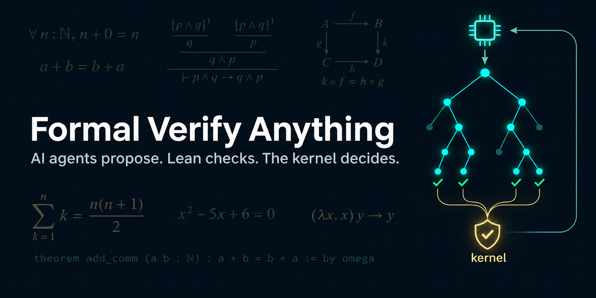

<div align="center">

# Formal Verify Anything

### Lean 4 と Mathlib のための、エージェント駆動の証明探索。

**AI エージェントが提案し、Lean が検査し、カーネルが判定する。**

[](https://github.com/allsmog/Formal-Verify-Anything/actions/workflows/formal.yml)
[](https://github.com/allsmog/Formal-Verify-Anything/releases)
[](../lean-toolchain)
[](../lake-manifest.json)
[](../LICENSE)
[](https://github.com/allsmog/Formal-Verify-Anything/discussions)

[English](../README.md) · [简体中文](README.zh-CN.md) · **日本語** · [한국어](README.ko.md) · [Español](README.es.md) · [Deutsch](README.de.md)

これは翻訳版です。正式な版は英語の README で、こちらより新しい場合があります。

**[ウェブサイト](https://allsmog.github.io/Formal-Verify-Anything/) · [ガイド](https://allsmog.github.io/Formal-Verify-Anything/guides/) · [ショーケース](https://allsmog.github.io/Formal-Verify-Anything/showcase/) · [ディスカッション](https://github.com/allsmog/Formal-Verify-Anything/discussions)**

[クイックスタート](#quick-start) · [エージェントと一緒に使う](#use-it-with-your-agent) · [仕組み](#how-it-works) · [結果](#results) · [セキュリティの例](#security-example)



</div>

---

Lean で定理を記述し、AI エージェントに証明を探索させ、Lean カーネルが受理したものだけを残します。

証明ステップを提案するのは、エージェント（Codex CLI 経由）または決定的なタクティクポリシーです。Lean はすべてのステップをコンパイルして新しいゴールを報告し、失敗した分岐は正確に親プランへロールバックされます。証明が受理されるのは、2 回の新規コンパイルとカーネル依存関係監査を通過した後だけです。すべての試行、ゴール状態、レシートが保存されるので、各証明がどのように見つかったかを確認し、自分で検証できます。

凍結した 24 問の miniF2F ホールドアウトセットで、Codex エージェントは **17/24**、決定的ベースラインは **11/24** を解きました。受理された証明はすべて、カーネル監査と独立した再コンパイルを通過しています。[結果](#results)を参照してください。

**デフォルトのソルバーは決定的なタクティク探索ベースラインです。** モデル呼び出しは行いません。明示的に指定した Codex CLI アダプター、または信頼済みのローカルコマンドを使うと、範囲を限定したゴールコンテキストとコンパイラのフィードバックをもとに、モデルが生成した提案を供給できます。これらの提案も同じ検証を受けます。決定的なスコアやフィクスチャテストを、実測したモデル性能として示すことはありません。

バージョン 0.2 には、最終検証を考慮した修復、任意で使える永続的な Lean 探索ワーカー、凍結した 24 問のホールドアウトでの比較、監査済みのアトミックトークン・セキュリティモデルが含まれます。

<a id="quick-start"></a>
## クイックスタート

前提条件：Node.js 22 以降、Git、[elan](https://github.com/leanprover/elan)。
このリポジトリは Lean 4.24.0 と Mathlib の特定のコミットに固定されています。

```sh
git clone https://github.com/allsmog/Formal-Verify-Anything.git
cd Formal-Verify-Anything
npm ci --prefix formal
lake exe cache get
lake build
node formal/src/cli.mjs doctor
node formal/src/cli.mjs solve benchmarks/tier1.json --id conjunction_commutation
```

`formal/` ランタイムは npm 依存のないプレーンな JavaScript です。

<a id="use-it-with-your-agent"></a>
## エージェントと一緒に使う

CLI は JSON の問題マニフェストを受け取り、JSON の結果を出力します。そのため、ターミナルコマンドを実行できるコーディングエージェントなら何でもこれを操作できます。エージェントにこのリポジトリを指定して、次のように依頼してください。

```text
Write my lemma as a Formal Verify Anything problem manifest, run
`node formal/src/cli.mjs solve` on it with `--proposer codex`, and show me the
accepted proof, the attempts it pruned, and the kernel audit.
```

探索ループの中でエージェントを提案器として使うには、Codex CLI を認証し（ChatGPT ログインまたは API キー）、`--proposer codex` を渡します。他のモデルは `--proposer-command` で接続できます。これは stdin から JSON リクエストを 1 つ読み取り、提案を返すローカルプログラムです。[formal/README.md](../formal/README.md) を参照してください。何がステップを提案したとしても、受理されるのは Lean とカーネル監査を通過した証明だけです。

<a id="how-it-works"></a>
## 仕組み

1. 元の定理宣言、インポート、ステートメントのハッシュをロックします。
2. Lean に、現在のターゲット、仮定、依存する let、universe パラメータ、ゴール構造を報告させます。
3. そのローカルコンテキストだけを提案ポリシーに送ります。提案では、タクティク、case/induction による分割、または継続部分を持つ構造化された `have` 補題を使えます。
4. 元の定理を含む新しいファイルで各分岐を再実行します。失敗した分岐は正確に親プランを復元します。すべての試行は、ソース、診断、終了コード、経過時間、エビデンスダイジェストを保持します。
5. コンパイラ呼び出し、提案ステップ、深さ、heartbeat、モデルトークン、実時間の予算を再帰木全体で共有します。
6. 独立した 2 回の新規コンパイラ起動が成功し、元の宣言が変更されておらず、依存関係監査がそのカーネル定理宣言を受理した場合にのみ、解決済みの証明を出力します。

最終検証がローカルで閉じた証明を拒否した場合、探索は残りの共有予算とコンパイラのフィードバックを使って再開します。以前の兄弟分岐を修復したり、分解方法を変えたりできます。`--compiler worker` は探索中にインポート済みのライブラリを再利用しますが、2 回の最終チェックは引き続き新しい Lean プロセスで実行されます。

中間プローブは、ゴールを報告した後、意図的にプライベートなセンチネルで失敗します。エラボレータが観測した状態は、解決済みの定理ではありません。後のエラー回復でゴールが残っていないと報告されても、それ以前にコンパイラエラーがあればそのプローブは無効になります。

最終ゲートは `sorry`、`admit`、新しい `axiom` 宣言、字句的なエスケープ、任意のエラボレータコマンド、コンパイラへの信頼を回避する近道を拒否します。推移的な証明依存関係を検査し、Lean の標準的な基礎公理である `propext`、`Classical.choice`、`Quot.sound` だけを許可します。
v2 ポリシーで許可されるのは、特定の未使用変数 linter 警告だけです。この警告はレシートに表示されたまま残ります。その他の警告は引き続き拒否の対象です。

<a id="results"></a>
## 結果

```sh
# Meaningful unit and real Lean integration checks
FVA_INTEGRATION=1 npm test --prefix formal

# Frozen 24-problem v2 evaluation, with a real provider-availability preflight
node benchmarks/v2/run.mjs --provider both --compiler worker

# Diagnostic v1 reruns never overwrite the published v1 results
node benchmarks/run.mjs --only mathd_algebra_142
```

[benchmarks/results.md](../benchmarks/results.md) には、実測結果、予算、定理ごとのコンパイラ呼び出し回数と再帰の深さ、失敗、生成されたすべての証明と試行へのリンクが含まれています。12 個の miniF2F テストステートメントは、ソルバーを一度も実行する前にファイル名で選びました。選んだ問題の失敗はすべて分母に残しています。[ベンチマークの出所](../benchmarks/README.md)を参照してください。

正規の **v1** ベースラインは **基礎定理 5/5、miniF2F 問題 8/12、合計 13/17 (76.5%)** を受理しました。**414 回のコンパイラ呼び出し**を行い、再帰の深さは **8** に達し、使用した **モデルトークンは 0** でした。4 件の失敗はすべて、コンパイラ呼び出しの予算を使い切ったものです。

[v2 評価](../benchmarks/v2/README.md)では、代数 8 問、数論 8 問、帰納法 8 問のステートメントを使います。これらは先の 12 個の miniF2F 項目とは重複しません。問題の選定と正確な宣言は、v2 の探索を始める前に凍結しました。ペア実行では、各手法は同じ制限のもとで定理ごとに 1 回の有界な起動を行いました。

| 手法 | 解決数 (pass@1) | コンパイラ呼び出し | モデルトークン |
| --- | ---: | ---: | ---: |
| Codex CLI 提案器 | **17/24** (70.8%) | 97 | 471,764（報告値） |
| 決定的ポリシー | **11/24** (45.8%) | 979 | 0 |

Codex は、決定的ポリシーが解いた定理をすべて解き、さらに 6 問を解きました。Codex の起動のうち 4 回はプロバイダのタイムアウトで終了し、トークン使用量が報告されなかったため、トークン総数は下限値です。[v2 レポート](../benchmarks/v2/results.md)では、代数、数論、帰納法ごとに結果を分け、すべての証明とトレースへのリンクを載せています。プロバイダのプリフライトがブロックされた場合は別途報告し、モデルのスコアに換算することはありません。

ここでの `pass@1` は、定理ごとに **有界探索ポリシー全体** を 1 回起動することを意味します。その起動の内部でのバックトラックも含みます。最初の候補での成功は別途報告します。探索を使い切っても、その定理が偽である、あるいは証明不可能であることを示すわけではありません。

CI は正規レポートと 17 個の期待 ID がすべてそろっていることを要求し、その後、記録された成功証明をすべて再コンパイルします。同じ整合性ゲートをローカルで実行するには、次のようにします。

```sh
node formal/scripts/recheck.mjs
```

<a id="select-a-proposer-or-compiler"></a>
## 提案器またはコンパイラを選ぶ

```sh
# Existing Codex authentication (ChatGPT login or API key) is required
node formal/src/cli.mjs doctor --proposer codex
node formal/src/cli.mjs solve benchmarks/tier1.json \
  --id conjunction_commutation --proposer codex --compiler worker \
  --model-token-budget 50000

# Deterministic worker mode requires no model account
node formal/src/cli.mjs solve benchmarks/tier1.json --compiler worker
```

CLI は、範囲を限定した JSON リクエストを stdin から 1 つ受け取り、提案と実測したトークン使用量を返す、信頼済みのローカルコマンドをサポートします。このコマンドはシェルを介さず、引数ベクタで起動されます。プロトコル、コマンドラインオプション、独立した証明検証については [formal/README.md](../formal/README.md) を参照してください。
[Codex アダプター](../formal/docs/codex-proposer.md)は、実際のプロバイダ使用量、不正な形式の応答、取得できなかった使用量を記録し、コストゼロのリクエストをでっち上げることはありません。
トークンの許容量は受け入れの閾値であり、プロバイダの課金上限ではありません。
[ワーカーガイド](../formal/docs/persistent-worker.md)では、キャッシュの分離、リソースの所有権、ワークフロー全体の測定結果を説明しています。

ポリシーは元のベンチマークの証明本体を一切参照できません。`MiniF2F` モジュールのインポートは禁止されており、ベンチマークの解答や admit された宣言を誤って再利用することを防ぎます。

<a id="security-example"></a>
## セキュリティの例

[アトミックトークンの例](../examples/security/README.md)は、認可された消費と拒否される自己ループを持つ fresh/spent の状態機械を定義します。監査済みの 4 つの証明は、有限トレース全体での保存則、高々 1 回の成功、消費後の再利用の拒否、2 回成功することの不可能性を示します。個別の問題マニフェストは定義だけをインポートするので、証明探索の実行がこの例の完成済み証明モジュールを再利用することはできません。これらの主張はこの抽象的なアトミックモデルに関するものです。Rust 実装の正しさや、ネットワーク配信の exactly-once 性を示すものではありません。

<a id="scope-and-limits"></a>
## 適用範囲と制限

これは実際に動作する有界の証明探索システムですが、任意の Lean 定理が解けることを保証するものではありません。汎用ポリシーは意図的に小さくしています。共有メタ変数で結合された case ゴールがあると、提案された bullet のレイアウトが古くなることがあります。ランナーはそのような分岐を保守的に拒否します。コンテキストには、見えているすべてのローカル仮定とその依存関係が保持されます。どの数学的前提が不要かを推測することはしません。

Lean、固定された Mathlib の成果物、観測ブリッジ、設定したローカル提案器コマンドは、信頼されたコンピューティング環境に属します。タクティクの受け入れ判定とカーネルチェックは、悪意のある Lean プラグインや悪意のあるローカルコマンドに対する OS のサンドボックスではありません。プロセスグループのタイムアウト処理は Linux と macOS でテスト済みです。Windows でのプロセスファミリーのクリーンアップは検証していません。

<a id="layout-and-licenses"></a>
## 構成とライセンス

- [formal/](../formal/)：JavaScript のオーケストレーション、提案器、CLI。
- [FormalVerify/Bridge.lean](../FormalVerify/Bridge.lean)：Lean のゴール観測とカーネル監査。
- [benchmarks/](../benchmarks/)：v1 と v2 のスイート、プロトコル、結果、全実行トレース。
- [examples/security/](../examples/security/)：アトミックトークンモデルとその証明タスク。
- [site/](../site/)：[ウェブサイト](https://allsmog.github.io/Formal-Verify-Anything/)のソース。`node site/build.mjs` が公開用ページを `docs/` に書き出します。
- [i18n/](../i18n/)：この README の翻訳。
- [SECURITY.md](../SECURITY.md)：脆弱性の報告方法と、ランナーが防御しない対象。
- [LICENSE](../LICENSE)：MIT。ベンチマークのステートメントは
  [benchmarks/licenses/](../benchmarks/licenses/) で miniF2F の告知を保持しています。
