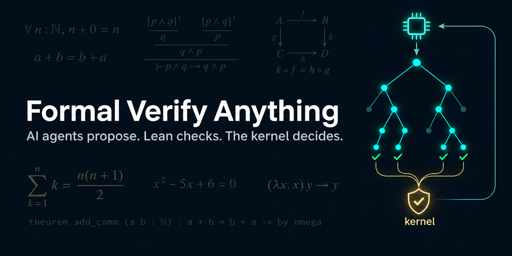

<div align="center">

# Formal Verify Anything

### Lean 4와 Mathlib을 위한 에이전트 기반 증명 탐색.

**AI 에이전트가 제안하고, Lean이 검사하며, 커널이 결정합니다.**

[](https://github.com/allsmog/Formal-Verify-Anything/actions/workflows/formal.yml)
[](https://github.com/allsmog/Formal-Verify-Anything/releases)
[](../lean-toolchain)
[](../lake-manifest.json)
[](../LICENSE)
[](https://github.com/allsmog/Formal-Verify-Anything/discussions)

[English](../README.md) · [简体中文](README.zh-CN.md) · [日本語](README.ja.md) · **한국어** · [Español](README.es.md) · [Deutsch](README.de.md)

이 문서는 번역본입니다. 기준 문서는 영어 README이며, 영어판이 더 최신일 수 있습니다.

**[웹사이트](https://allsmog.github.io/Formal-Verify-Anything/) · [가이드](https://allsmog.github.io/Formal-Verify-Anything/guides/) · [쇼케이스](https://allsmog.github.io/Formal-Verify-Anything/showcase/) · [토론](https://github.com/allsmog/Formal-Verify-Anything/discussions)**

[빠른 시작](#quick-start) · [에이전트와 함께 사용하기](#use-it-with-your-agent) · [작동 방식](#how-it-works) · [결과](#results) · [보안 예제](#security-example)



</div>

---

Lean으로 정리를 기술하세요. AI 에이전트가 증명을 탐색하게 하세요. Lean 커널이 수락한 것만 남기세요.

증명 단계는 에이전트(Codex CLI를 통해) 또는 결정론적 택틱 정책이 제안합니다. Lean은 모든 단계를 컴파일하고 새 목표(goal)를 보고하며, 실패한 분기는 정확히 부모 계획으로 롤백됩니다. 증명은 두 번의 새로운 컴파일과 커널 의존성 감사를 통과한 뒤에만 수락됩니다. 모든 시도, 목표 상태, 영수증(receipt)이 저장되므로 각 증명이 어떻게 발견되었는지 확인하고 직접 검증할 수 있습니다.

고정된 24문제 miniF2F 홀드아웃 세트에서 Codex 에이전트는 **17/24**, 결정론적 기준선은 **11/24**를 풀었습니다. 수락된 모든 증명은 커널 감사와 독립적인 재컴파일을 통과했습니다. [결과](#results)를 참고하세요.

**기본 솔버는 결정론적 택틱 탐색 기준선입니다.** 모델을 호출하지 않습니다. 명시적으로 지정한 Codex CLI 어댑터나 신뢰할 수 있는 로컬 명령은 범위가 제한된 목표 컨텍스트와 컴파일러 피드백을 바탕으로 모델이 생성한 제안을 공급할 수 있으며, 이 제안들도 같은 검증을 거칩니다. 결정론적 점수와 픽스처 테스트를 실측한 모델 성능으로 제시하는 일은 없습니다.

버전 0.2에는 최종 검증을 고려한 복구, 선택적으로 쓸 수 있는 상주형 Lean 탐색 워커, 고정된 24문제 홀드아웃 비교, 감사를 거친 원자적 토큰(atomic-token) 보안 모델이 포함됩니다.

<a id="quick-start"></a>
## 빠른 시작

사전 요구 사항: Node.js 22 이상, Git, [elan](https://github.com/leanprover/elan).
저장소는 Lean 4.24.0과 정확한 Mathlib 커밋을 고정합니다.

```sh
git clone https://github.com/allsmog/Formal-Verify-Anything.git
cd Formal-Verify-Anything
npm ci --prefix formal
lake exe cache get
lake build
node formal/src/cli.mjs doctor
node formal/src/cli.mjs solve benchmarks/tier1.json --id conjunction_commutation
```

`formal/` 런타임은 npm 의존성이 없는 순수 JavaScript입니다.

<a id="use-it-with-your-agent"></a>
## 에이전트와 함께 사용하기

CLI는 JSON 문제 매니페스트를 받아 JSON 결과를 출력하므로, 터미널 명령을 실행할 수 있는 코딩 에이전트라면 무엇이든 이를 구동할 수 있습니다. 에이전트에게 이 저장소를 알려 주고 다음과 같이 요청하세요.

```text
Write my lemma as a Formal Verify Anything problem manifest, run
`node formal/src/cli.mjs solve` on it with `--proposer codex`, and show me the
accepted proof, the attempts it pruned, and the kernel audit.
```

탐색 루프 안에서 에이전트를 제안기로 사용하려면 Codex CLI를 인증하고(ChatGPT 로그인 또는 API 키) `--proposer codex`를 전달하세요. 다른 모델은 `--proposer-command`로 연결할 수 있습니다. 이는 stdin에서 JSON 요청 하나를 읽고 제안을 반환하는 로컬 프로그램입니다. [formal/README.md](../formal/README.md)를 참고하세요. 무엇이 단계를 제안하든, Lean과 커널 감사를 통과한 증명만 수락됩니다.

<a id="how-it-works"></a>
## 작동 방식

1. 원래 정리 선언, import, 명제 해시를 고정합니다.
2. Lean에 현재 대상, 가설, 의존적 let, universe 매개변수, 목표 구조를 보고하도록 요청합니다.
3. 그 로컬 컨텍스트만 제안 정책에 보냅니다. 제안은 택틱, case/induction 분할, 또는 후속 부분이 있는 구조화된 `have` 보조정리를 사용할 수 있습니다.
4. 원래 정리를 포함한 새 파일에서 각 분기를 재실행합니다. 실패한 분기는 정확히 부모 계획을 복원하며, 모든 시도는 소스, 진단, 종료 코드, 경과 시간, 증거 다이제스트를 보존합니다.
5. 컴파일러 호출, 제안 단계, 깊이, heartbeat, 모델 토큰, 실제 경과 시간(wall-time) 예산을 재귀 트리 전체에서 공유합니다.
6. 두 번의 새로운 독립 컴파일러 실행이 성공하고, 원래 선언이 변경되지 않았으며, 의존성 감사가 그 커널 정리 선언을 수락한 경우에만 해결된 증명을 출력합니다.

최종 검증이 로컬에서 닫힌 증명을 거부하면, 남은 공유 예산과 컴파일러 피드백으로 탐색을 재개합니다. 앞선 형제 분기를 복구하거나 분해 방식을 바꿀 수 있습니다. `--compiler worker`는 탐색 중에 import한 라이브러리를 재사용하지만, 두 번의 최종 검사는 여전히 새 Lean 프로세스에서 실행됩니다.

중간 프로브는 목표를 보고한 뒤 비공개 센티널로 의도적으로 실패합니다. 엘라보레이터(elaborator)가 관찰한 상태는 해결된 정리가 아닙니다. 이후의 오류 복구가 남은 목표가 없다고 보고하더라도, 그 이전에 컴파일러 오류가 있었다면 프로브는 무효가 됩니다.

최종 게이트는 `sorry`, `admit`, 새로운 `axiom` 선언, 어휘적 탈출, 임의의 엘라보레이터 명령, 컴파일러 신뢰를 우회하는 지름길을 거부합니다. 증명의 전이적 의존성을 검사하고 Lean의 일반적인 기초 공리인 `propext`, `Classical.choice`, `Quot.sound`만 허용합니다.
v2 정책에서는 정확히 그 미사용 변수 linter 경고만 허용되며, 이 경고는 영수증에 그대로 표시됩니다. 다른 경고는 여전히 거부 사유입니다.

<a id="results"></a>
## 결과

```sh
# Meaningful unit and real Lean integration checks
FVA_INTEGRATION=1 npm test --prefix formal

# Frozen 24-problem v2 evaluation, with a real provider-availability preflight
node benchmarks/v2/run.mjs --provider both --compiler worker

# Diagnostic v1 reruns never overwrite the published v1 results
node benchmarks/run.mjs --only mathd_algebra_142
```

[benchmarks/results.md](../benchmarks/results.md)에는 실측 결과, 예산, 정리별 컴파일러 호출 수와 재귀 깊이, 실패, 생성된 모든 증명과 시도로의 링크가 있습니다. 12개의 miniF2F 테스트 명제는 솔버를 한 번도 실행하기 전에 파일 이름으로 선정했습니다. 선정된 문제의 실패는 모두 분모에 남아 있습니다. [벤치마크 출처](../benchmarks/README.md)를 참고하세요.

정식 **v1** 기준선이 수락한 결과는 다음과 같습니다: **기초 정리 5/5개와 miniF2F 문제 8/12개, 전체 13/17 (76.5%)**. **컴파일러 호출 414회**를 사용했고, 재귀 깊이 **8**에 도달했으며, **모델 토큰은 0개**를 사용했습니다. 네 건의 실패는 모두 컴파일러 호출 예산을 소진한 경우입니다.

[v2 평가](../benchmarks/v2/README.md)는 대수 8개, 정수론 8개, 귀납법 8개 명제를 사용하며, 앞의 12개 miniF2F 항목과 겹치지 않습니다. 선정 대상과 정확한 선언은 v2 탐색을 시작하기 전에 고정했습니다. 쌍 실행(paired run)에서 각 방법은 동일한 제한 아래 정리마다 한 번의 유계 실행 기회를 얻었습니다.

| 방법 | 해결 (pass@1) | 컴파일러 호출 | 모델 토큰 |
| --- | ---: | ---: | ---: |
| Codex CLI 제안기 | **17/24** (70.8%) | 97 | 471,764 (보고값) |
| 결정론적 정책 | **11/24** (45.8%) | 979 | 0 |

Codex는 결정론적 정책이 푼 정리를 모두 풀었고, 여섯 개를 더 풀었습니다. Codex 실행 중 네 번은 토큰 사용량을 보고하지 않은 제공자 타임아웃으로 끝났으므로, 토큰 합계는 하한값입니다. [v2 보고서](../benchmarks/v2/results.md)는 대수, 정수론, 귀납법별로 결과를 나누어 보여 주고 모든 증명과 트레이스로 링크합니다. 제공자 사전 점검(preflight)이 차단되면 별도로 보고하며, 이를 모델 점수로 환산하지 않습니다.

여기서 `pass@1`은 정리마다 **전체 유계 탐색 정책**을 한 번 실행하는 것을 뜻합니다. 그 실행 내부의 백트래킹도 포함됩니다. 첫 번째 후보의 성공 여부는 별도로 보고합니다. 탐색이 소진되었다고 해서 그 정리가 거짓이거나 증명 불가능하다는 뜻은 아닙니다.

CI는 정식 보고서와 예상되는 17개 ID가 모두 있는지 확인한 뒤, 기록된 성공 증명을 모두 다시 컴파일합니다. 같은 무결성 게이트를 로컬에서 실행하려면 다음을 실행하세요.

```sh
node formal/scripts/recheck.mjs
```

<a id="select-a-proposer-or-compiler"></a>
## 제안기 또는 컴파일러 선택

```sh
# Existing Codex authentication (ChatGPT login or API key) is required
node formal/src/cli.mjs doctor --proposer codex
node formal/src/cli.mjs solve benchmarks/tier1.json \
  --id conjunction_commutation --proposer codex --compiler worker \
  --model-token-budget 50000

# Deterministic worker mode requires no model account
node formal/src/cli.mjs solve benchmarks/tier1.json --compiler worker
```

CLI는 범위가 제한된 JSON 요청 하나를 stdin으로 받아 제안과 실측 토큰 사용량을 반환하는, 신뢰할 수 있는 로컬 명령을 지원합니다. 이 명령은 셸 없이 인자 벡터로 실행됩니다. 프로토콜, 명령줄 옵션, 독립적인 증명 검증은 [formal/README.md](../formal/README.md)를 참고하세요.
[Codex 어댑터](../formal/docs/codex-proposer.md)는 실제 제공자 사용량, 형식이 잘못된 응답, 확인할 수 없는 사용량을 기록하며, 비용이 0인 요청을 지어내지 않습니다.
토큰 허용량은 수락 임계값이며, 제공자 청구 한도가 아닙니다.
[워커 가이드](../formal/docs/persistent-worker.md)는 캐시 격리, 리소스 소유권, 전체 워크플로 측정 결과를 설명합니다.

정책은 원래 벤치마크의 증명 본문에 접근할 수 없습니다. `MiniF2F` 모듈의 import는 금지되어 있어, 벤치마크 정답이나 admit된 선언을 실수로 재사용하는 일을 막습니다.

<a id="security-example"></a>
## 보안 예제

[원자적 토큰 예제](../examples/security/README.md)는 승인된 소비와 거부되는 자기 루프를 갖춘 fresh/spent 상태 기계를 정의합니다. 감사를 거친 네 개의 증명은 유한 트레이스 전반에서의 보존, 최대 한 번의 성공, 소비 후 재사용 거부, 두 번 성공하는 것의 불가능성을 확립합니다. 별도의 문제 매니페스트는 정의만 import하므로, 증명 탐색 실행이 예제의 완성된 증명 모듈을 재사용할 수 없습니다. 이 주장들은 이 추상적인 원자적 모델에 관한 것이며, Rust 구현의 정확성이나 네트워크 전달의 정확히 한 번(exactly-once) 보장을 확립하지는 않습니다.

<a id="scope-and-limits"></a>
## 범위와 한계

이 시스템은 실제로 동작하는 유계 증명 탐색 시스템이지만, 임의의 Lean 정리가 풀린다는 보장은 아닙니다. 범용 정책은 의도적으로 작게 만들었습니다. 공유 메타변수로 묶인 case 목표가 있으면 제안된 bullet 레이아웃이 낡은 상태가 될 수 있으며, 러너는 그런 분기를 보수적으로 거부합니다. 컨텍스트는 보이는 모든 로컬 가설과 그 의존성을 유지하며, 어떤 수학적 전제가 생략 가능한지 추측하지 않습니다.

Lean, 고정된 Mathlib 아티팩트, 관찰 브리지, 설정된 로컬 제안기 명령은 신뢰된 컴퓨팅 환경에 속합니다. 택틱 수락 검사와 커널 검사는 악의적인 Lean 플러그인이나 악의적인 로컬 명령에 대한 운영체제 샌드박스가 아닙니다. 프로세스 그룹 타임아웃 처리는 Linux와 macOS에서 테스트했으며, Windows의 프로세스 계열 정리는 검증하지 않았습니다.

<a id="layout-and-licenses"></a>
## 구성과 라이선스

- [formal/](../formal/): JavaScript 오케스트레이션, 제안기, CLI.
- [FormalVerify/Bridge.lean](../FormalVerify/Bridge.lean): Lean 목표 관찰과 커널 감사.
- [benchmarks/](../benchmarks/): v1 및 v2 스위트, 프로토콜, 결과, 전체 실행 트레이스.
- [examples/security/](../examples/security/): 원자적 토큰 모델과 그 증명 과제.
- [site/](../site/): [웹사이트](https://allsmog.github.io/Formal-Verify-Anything/) 소스. `node site/build.mjs`가 게시용 페이지를 `docs/`에 생성합니다.
- [i18n/](../i18n/): 이 README의 번역본.
- [SECURITY.md](../SECURITY.md): 취약점 보고 방법과 러너가 보호하지 않는 범위.
- [LICENSE](../LICENSE): MIT. 벤치마크 명제는
  [benchmarks/licenses/](../benchmarks/licenses/)에 miniF2F 고지를 유지합니다.
