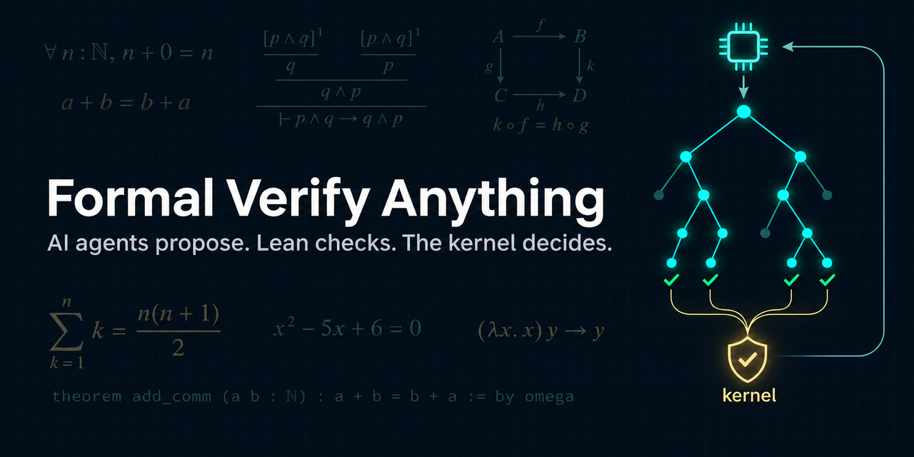

<div align="center">

# Formal Verify Anything

### 面向 Lean 4 和 Mathlib 的智能体驱动证明搜索。

**AI 智能体提出，Lean 检查，内核 (kernel) 裁决。**

[](https://github.com/allsmog/Formal-Verify-Anything/actions/workflows/formal.yml)
[](https://github.com/allsmog/Formal-Verify-Anything/releases)
[](../lean-toolchain)
[](../lake-manifest.json)
[](../LICENSE)
[](https://github.com/allsmog/Formal-Verify-Anything/discussions)

[English](../README.md) · **简体中文** · [日本語](README.ja.md) · [한국어](README.ko.md) · [Español](README.es.md) · [Deutsch](README.de.md)

这是翻译版本。英文 README 是权威版本，内容可能更新。

**[网站](https://allsmog.github.io/Formal-Verify-Anything/) · [指南](https://allsmog.github.io/Formal-Verify-Anything/guides/) · [案例展示](https://allsmog.github.io/Formal-Verify-Anything/showcase/) · [讨论区](https://github.com/allsmog/Formal-Verify-Anything/discussions)**

[快速开始](#quick-start) · [与你的智能体一起使用](#use-it-with-your-agent) · [工作原理](#how-it-works) · [结果](#results) · [安全示例](#security-example)



</div>

---

用 Lean 陈述一个定理，让 AI 智能体去搜索证明，只保留 Lean 内核接受的结果。

证明步骤由智能体（通过 Codex CLI）或确定性的 tactic 策略提出。Lean 编译每一步并报告新的目标，失败的分支回滚到确切的父计划，只有在两次全新编译和一次内核依赖审计都通过后，证明才会被接受。每次尝试、目标状态和回执都会被保存，因此你可以看到每个证明是怎样找到的，并自行检查。

在一个冻结的 24 题 miniF2F 留出集上，Codex 智能体解决了 **17/24**，确定性基线解决了 **11/24**。每个被接受的证明都通过了内核审计和一次独立的重新编译。参见[结果](#results)。

**默认求解器是一个确定性的 tactic 搜索基线。** 它不调用任何模型。显式启用的 Codex CLI 适配器或受信任的本地命令可以提供模型生成的提议，并附带限定范围的目标上下文和编译器反馈；这些提议接受同样的验证。确定性得分和 fixture 测试从不被当作实测的模型性能来呈现。

0.2 版包括感知最终验证的修复、可选的持久化 Lean 探索 worker、冻结的 24 题留出集对比，以及经过审计的原子令牌（atomic-token）安全模型。

<a id="quick-start"></a>
## 快速开始

前置条件：Node.js 22 或更高版本、Git，以及 [elan](https://github.com/leanprover/elan)。
仓库固定了 Lean 4.24.0 和一个确切的 Mathlib 提交。

```sh
git clone https://github.com/allsmog/Formal-Verify-Anything.git
cd Formal-Verify-Anything
npm ci --prefix formal
lake exe cache get
lake build
node formal/src/cli.mjs doctor
node formal/src/cli.mjs solve benchmarks/tier1.json --id conjunction_commutation
```

`formal/` 运行时是纯 JavaScript，没有任何 npm 依赖。

<a id="use-it-with-your-agent"></a>
## 与你的智能体一起使用

CLI 接收一个 JSON 问题清单并输出 JSON 结果，因此任何能运行终端命令的编码智能体都可以驱动它。让你的智能体指向这个仓库，然后这样要求：

```text
Write my lemma as a Formal Verify Anything problem manifest, run
`node formal/src/cli.mjs solve` on it with `--proposer codex`, and show me the
accepted proof, the attempts it pruned, and the kernel audit.
```

要在搜索循环中把智能体用作提议器，请先完成 Codex CLI 认证（ChatGPT 登录或 API 密钥），再传入 `--proposer codex`。其他任何模型都可以通过 `--proposer-command` 接入，它是一个本地程序，从 stdin 读取一个 JSON 请求并返回提议；参见 [formal/README.md](../formal/README.md)。无论由谁提出步骤，只有通过 Lean 和内核审计的证明才会被接受。

<a id="how-it-works"></a>
## 工作原理

1. 锁定原始定理声明、导入和陈述哈希。
2. 让 Lean 报告当前目标、假设、依赖的 let 绑定、universe 参数和目标结构。
3. 只把这部分局部上下文发送给提议策略。提议可以使用 tactic、case/induction 拆分，或者带后续部分的结构化 `have` 子引理。
4. 在包含原始定理的全新文件中重放每个分支。失败的分支恢复到确切的父计划；每次尝试都保留其源码、诊断信息、退出码、耗时和证据摘要。
5. 编译器调用、提议步数、深度、heartbeat、模型 token 和墙钟时间的预算在整个递归树中共享。
6. 只有在两次全新的独立编译器调用都成功、原始声明未被改动、并且依赖审计接受其内核定理声明之后，才输出已解决的证明。

如果最终验证拒绝了一个在局部已闭合的证明，搜索会带着剩余的共享预算和编译器反馈继续进行。它可以修复较早的兄弟分支，或者改变分解方式。`--compiler worker` 在探索期间复用已导入的库，而两次最终检查仍然在全新的 Lean 进程中运行。

中间探针在报告目标后会有意以一个私有哨兵值失败。elaborator 观察到的状态并不等于已解决的定理。即使后续的错误恢复报告没有剩余目标，较早的编译器错误也会使探针无效。

最终关卡拒绝 `sorry`、`admit`、新的 `axiom` 声明、词法逃逸、任意 elaborator 命令以及绕过编译器信任的捷径。它检查传递性的证明依赖，只允许 Lean 常用的基础公理：`propext`、`Classical.choice` 和 `Quot.sound`。
在 v2 策略下，只允许那一条确切的未使用变量 linter 警告；它仍会在回执中显示。其他警告仍然会导致拒绝。

<a id="results"></a>
## 结果

```sh
# Meaningful unit and real Lean integration checks
FVA_INTEGRATION=1 npm test --prefix formal

# Frozen 24-problem v2 evaluation, with a real provider-availability preflight
node benchmarks/v2/run.mjs --provider both --compiler worker

# Diagnostic v1 reruns never overwrite the published v1 results
node benchmarks/run.mjs --only mathd_algebra_142
```

[benchmarks/results.md](../benchmarks/results.md) 包含实测结果、预算、每个定理的编译器调用次数和递归深度、失败情况，以及指向每个生成的证明和尝试的链接。这十二个 miniF2F 测试陈述是在任何求解器运行之前按文件名选定的。每个被选中题目的失败都保留在分母中。参见[基准来源说明](../benchmarks/README.md)。

规范的 **v1** 基线接受了 **5/5 个基础定理和 8/12 个 miniF2F 问题：总计 13/17 (76.5%)**。它进行了 **414 次编译器调用**，达到递归深度 **8**，使用了 **0 个模型 token**。全部四个失败都是因为耗尽了编译器调用预算。

[v2 评估](../benchmarks/v2/README.md)使用八个代数、八个数论和八个归纳陈述，与上述十二个 miniF2F 条目不相交。它的选题和确切声明在任何 v2 搜索之前就已冻结。在配对运行中，每种方法对每个定理在相同限制下获得一次有界调用：

| 方法 | 已解决 (pass@1) | 编译器调用 | 模型 token |
| --- | ---: | ---: | ---: |
| Codex CLI 提议器 | **17/24** (70.8%) | 97 | 471,764（已报告） |
| 确定性策略 | **11/24** (45.8%) | 979 | 0 |

Codex 解决了确定性策略解决的每一个定理，另外还多解决了六个。有四次 Codex 调用以提供方超时结束，且未报告 token 用量，因此 token 总数是一个下界。[v2 报告](../benchmarks/v2/results.md)按代数、数论和归纳分类给出结果，并链接到每个证明和追踪记录。如果提供方预检被阻止，会单独报告，绝不会换算成模型得分。

这里的 `pass@1` 指对每个定理调用一次**整个有界搜索策略**。它包括该次调用内部的回溯。首个候选的成功率单独报告。搜索耗尽并不说明该定理为假或不可证明。

CI 要求存在规范报告和全部十七个预期 ID，然后重新编译每个已记录的成功证明。要在本地运行同样的完整性关卡：

```sh
node formal/scripts/recheck.mjs
```

<a id="select-a-proposer-or-compiler"></a>
## 选择提议器或编译器

```sh
# Existing Codex authentication (ChatGPT login or API key) is required
node formal/src/cli.mjs doctor --proposer codex
node formal/src/cli.mjs solve benchmarks/tier1.json \
  --id conjunction_commutation --proposer codex --compiler worker \
  --model-token-budget 50000

# Deterministic worker mode requires no model account
node formal/src/cli.mjs solve benchmarks/tier1.json --compiler worker
```

CLI 支持一个受信任的本地命令，它从 stdin 接收一个限定范围的 JSON 请求，返回提议以及实测的 token 用量。该命令以参数向量方式启动，不经过 shell。协议、命令行选项和独立证明验证参见 [formal/README.md](../formal/README.md)。
[Codex 适配器](../formal/docs/codex-proposer.md)会记录实际的提供方用量、格式错误的响应和不可用的用量，不会虚构零成本的请求。
token 额度是一个准入阈值，而不是提供方的计费上限。
[worker 指南](../formal/docs/persistent-worker.md)记录了缓存隔离、资源归属和完整工作流的测量结果。

策略无法获取任何原始基准证明体。禁止导入 `MiniF2F` 模块，以防意外复用基准答案或通过 admit 接受的声明。

<a id="security-example"></a>
## 安全示例

[原子令牌示例](../examples/security/README.md)定义了一个 fresh/spent 状态机，包含经授权的消费和被拒绝的自环。它的四个经过审计的证明分别确立了：有限轨迹上的守恒、至多一次成功、消费后拒绝重用，以及不可能出现两次成功。独立的问题清单只导入定义，因此证明搜索运行无法复用该示例已完成的证明模块。这些结论只涉及这个抽象的原子模型；它们并不能确立某个 Rust 实现的正确性，也不能确立网络传递的恰好一次语义。

<a id="scope-and-limits"></a>
## 范围与限制

这是一个可用的有界证明搜索系统，并不保证能解决任意 Lean 定理。通用策略被刻意设计得很小。通过共享元变量耦合的 case 目标可能使提议的 bullet 布局失效；运行器会保守地拒绝这些分支。上下文保留所有可见的局部假设及其依赖；它不会猜测哪些数学前提可以省略。

Lean、固定版本的 Mathlib 产物、观察桥接层以及配置的本地提议器命令都属于受信任的计算环境。tactic 准入和内核检查并不是针对恶意 Lean 插件或恶意本地命令的操作系统沙箱。进程组超时处理已在 Linux 和 macOS 上测试；Windows 上的进程族清理尚未验证。

<a id="layout-and-licenses"></a>
## 目录结构与许可证

- [formal/](../formal/)：JavaScript 编排逻辑、提议器和 CLI。
- [FormalVerify/Bridge.lean](../FormalVerify/Bridge.lean)：Lean 目标观察和内核审计。
- [benchmarks/](../benchmarks/)：v1 和 v2 测试集、协议、结果和完整运行追踪。
- [examples/security/](../examples/security/)：原子令牌模型及其证明任务。
- [site/](../site/)：[网站](https://allsmog.github.io/Formal-Verify-Anything/)的源文件。`node site/build.mjs` 会把发布的页面写入 `docs/`。
- [i18n/](../i18n/)：本 README 的各语言译本。
- [SECURITY.md](../SECURITY.md)：如何报告漏洞，以及运行器不防护哪些情况。
- [LICENSE](../LICENSE)：MIT。基准陈述在
  [benchmarks/licenses/](../benchmarks/licenses/) 中保留其 miniF2F 声明。
